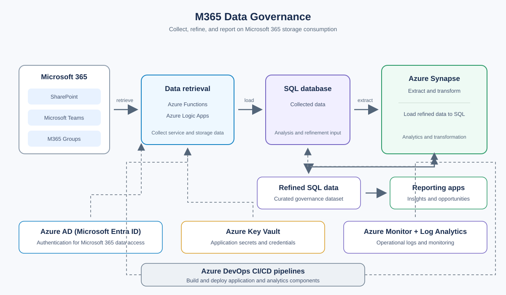
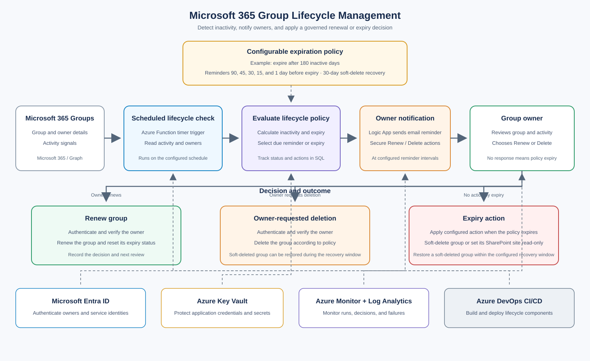

# Objective

Provide visibility into storage consumption across SharePoint, Microsoft Teams, and Microsoft 365 Groups, and identify opportunities for data cleanup and lifecycle management. The solution also identifies inactive Microsoft 365 groups and lets their owners decide whether to renew or delete them before they become obsolete.

## Architecture flow
1. Azure Functions and Logic Apps use Microsoft Entra ID to authenticate to Microsoft 365 services in order to retrieve service and storage data for all Microsoft 365 services.
2. The collected data is loaded into a SQL database for analysis.
3. Azure Synapse extracts and transforms the data, then loads the refined results into SQL.
4. Reporting applications use the refined data to present storage consumption and highlight cleanup and lifecycle-management opportunities.
5. Azure Key Vault stores application secrets, while Azure Monitor and Log Analytics collect operational logs.
6. Azure DevOps CI/CD pipelines build and deploy project components.

## Microsoft 365 Group lifecycle management

### Objective

Identify inactive Microsoft 365 (O365) groups and give their owners the opportunity to retain or delete them. This helps optimize tenant resources and prevent obsolete group data from accumulating.

### Lifecycle workflow

1. A scheduled lifecycle check retrieves group activity and owner information from Microsoft 365.
2. The solution compares each group's inactivity against a configurable expiration policy and calculates when it is due to expire.
3. As expiry approaches, owners receive email reminders with secure options to renew the group or request its deletion. The action is authenticated with Microsoft Entra ID and validated before the group is changed.
4. Renewing a group resets its lifecycle/expiry status. If an owner requests deletion, the group is deleted according to the configured policy.
5. If no owner action is taken by the expiry date, the configured expiry action is applied. Soft-deleted groups can be restored during the tenant's recovery window.

The supplied design shows an example policy of expiration after 180 days of inactivity, reminders 90, 45, 30, 15, and 1 day before expiry, and a 30-day recovery period for soft-deleted groups. Treat these as configurable policy values and confirm them against tenant requirements before implementation. An expiry action may also set the associated SharePoint site to read-only if that behavior is enabled in the policy.

# Technologies used

- Microsoft 365 (SharePoint, Microsoft Teams, and Microsoft 365 Groups)
- Azure AD (Microsoft Entra ID) authentication
- Azure Key Vault
- Azure Functions
- Azure Logic Apps
- Microsoft Graph / Microsoft 365 activity signals
- Azure Synapse Analytics
- SQL database
- Reporting applications
- Azure Monitor and Log Analytics
- Azure DevOps CI/CD pipelines

# DevOps

## Infrastructure

[Bicep Modules for Infrastructure as Code](https://github.com/jeevitharaju94/azure-bicep-library/tree/main/infrastructure)

## Pipelines

[Azure DevOps CI/CD pipelines](https://github.com/jeevitharaju94/azure-bicep-library/tree/main/pipelines)

# Outcome

- Consolidated visibility into storage consumption across Microsoft 365 services
- Refined data available to reporting applications
- Improved ability to identify data cleanup and lifecycle-management opportunities
- Centralized application secret management and operational logging
- Repeatable CI/CD deployment process
- Owner-driven renewal and deletion workflow for inactive Microsoft 365 groups
- Reduced accumulation of obsolete group data through configurable expiration policies