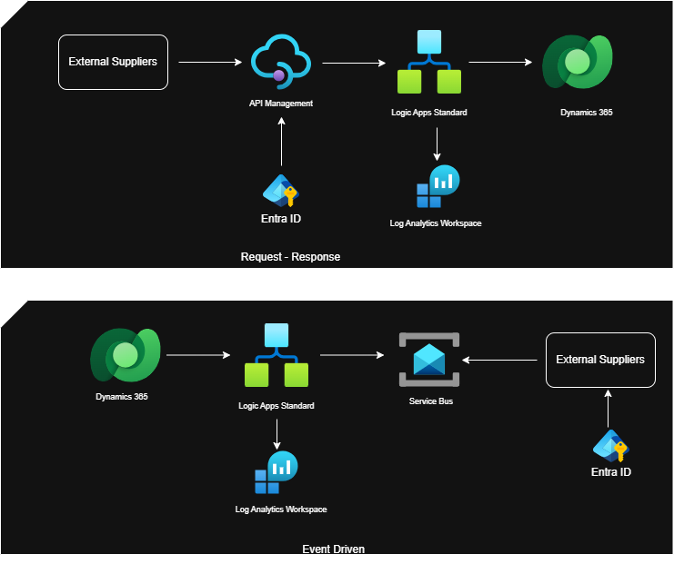

# Objective

 The main objective of this project is to enable external suppliers the acccess to CRM funcitonality without directly exposing the CRM.

 

# Technologies used

 - Azure API Management
 - Logic Apps Standard
 - Dynamics 365 CRM
 - Service Bus Topics
 - Entra ID
 - Log Analytics Workspace

# DevOps

## Infrastructure

[Bicep Modules](../../azure-bicep-library/infrastructure/)

## Pipelines

[CI/CD Pipelines](../../azure-bicep-library/infrastructure/)

# Outcome

- Scalable architecture
- Near real-time processing
- Improved resilience